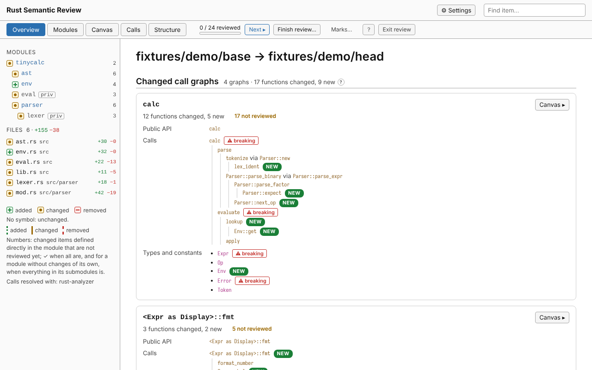

# Rust Semantic Review (prototype)

> [!WARNING]
> This is a vibe-coded toy project, written mostly by an AI coding assistant. Expect bugs and rough edges, and use it with care. In particular, don't rely on its output as the only basis for a review.

Review a Rust pull request as **changed items** (types, traits, functions, impls, modules) instead of changed lines. The tool compares the base and head versions and writes one self-contained HTML page with an overview of the public API changes and their SemVer impact, module pages, a canvas to follow calls, and a review mode that posts to GitHub.



By default the analyzed code is never built or run. See [docs/features.md](docs/features.md) for what the page shows, [docs/usage.md](docs/usage.md) for details on the options, [docs/how-it-works.md](docs/how-it-works.md) for the analysis, its safety model and its limits, and [docs/design.md](docs/design.md) for the design.

## GitHub Action

Builds the page for every pull request and links it in a comment:

```yaml
# .github/workflows/rust-semantic-review.yml
name: Rust Semantic Review
on:
  pull_request:
  push:
    branches: [main] # optional: fills the build cache that PRs start from
permissions:
  contents: read
  pull-requests: write
jobs:
  explore:
    runs-on: ubuntu-latest
    steps:
      - uses: phil-opp/rust-semantic-review@main
```

| Input | Default | |
|---|---|---|
| `comment` | `true` | Post a comment that links the page (and a page of the changes since the previous comment). |
| `syntax-only` | `false` | Skip rust-analyzer: faster, but method calls stay unresolved. |
| `trust-project-code` | `auto` | Run the PR's build scripts and proc macros, so calls into generated code resolve. `auto`: on under `pull_request`, off when another event analyzes a PR. Refused under `pull_request_target`. |
| `semver-checks` | `false` | Also run cargo-semver-checks. Builds the PR's code; refused under `pull_request_target`. |
| `cache` / `save-cache` | `true` / on the default branch | Cache the built tool / also its dependencies. |
| `cache-target` | `false` | In trusted mode, also cache the analysis' target directory: much faster, but can take several GB. |
| `retention-days` | repository setting | How long the page is kept. |
| `pr`, `repository` | the triggering PR | Analyze another pull request. |

The pages are stored as artifacts of the workflow run: opening one needs a GitHub login with access to the repository, and they expire with the run's artifacts (90 days unless the repository or `retention-days` sets otherwise).

## Command line

```sh
cargo build --release   # rustup installs the toolchain from rust-toolchain.toml

./target/release/rust-semantic-review pr rust-lang/log#613   # needs git; gh adds the title and review threads
./target/release/rust-semantic-review git path/to/repo main my-branch
./target/release/rust-semantic-review dirs fixtures/demo/base fixtures/demo/head
```

| Option | |
|---|---|
| `-o FILE` | Output page (default `rust-semantic-review.html`). |
| `--json FILE` | Also write the analysis as JSON. |
| `--syntax-only` | Skip rust-analyzer. |
| `--trust-project-code` | Run build scripts and proc macros. Only in a sandbox. |
| `--target-dir DIR` | With trust: keep the build between runs. |
| `--semver-checks` | Also run cargo-semver-checks (`cargo install cargo-semver-checks`). Only in a sandbox. |
| `--base REV` | `pr`: compare against this revision instead of the merge base. |
| `--since COMMIT` | `pr`: also write a page of what changed since an earlier commit of the PR. |

`cargo build --release --features wasm-opt` makes the page smaller, at the cost of about 5 more minutes of build time.

Crates that don't follow SemVer on purpose can mark their breaking changes as allowed:

```toml
[package.metadata.rust-semantic-review]
allow-breaking-changes = true
```

## Development

CI runs `cargo fmt`, clippy, the tests, and a headless browser smoke test of the demo page (`ci/smoke.mjs`); see [docs/how-it-works.md](docs/how-it-works.md#development) to run it locally.
